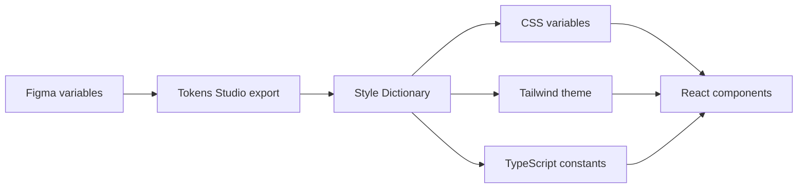

# NokGridCore

**The design system for data-dense products.** Tokens, a Figma library and React components, all generated from one source.

[](https://www.npmjs.com/package/@nokgridcore/ui)
[](https://www.npmjs.com/package/@nokgridcore/tokens)
[](LICENSE)

**[Browse the Storybook](https://nokgrid-ui.vercel.app/)**: every component, variant and token, live.

<!-- Add when public: Figma library link -->

---

## The idea

A design file and a codebase usually start in sync and drift apart one small change at a time: a colour tweaked in Figma but not in CSS, a new button state that only exists in code.

NokGridCore removes that gap. Every colour, size, space and radius is defined once, as a Figma variable, and a build step turns those variables into the CSS, Tailwind and TypeScript the components are written with. Change the design and the code follows. There is no second copy to keep up to date.

## Built for dashboards

Most component libraries are designed around forms and marketing pages. NokGridCore is designed around the screens where people read data.

| On a dashboard you need…                  | NokGridCore gives you                                                     |
| ----------------------------------------- | ------------------------------------------------------------------------- |
| Numbers people can read at a glance       | KPI cards with value, delta and trend direction                           |
| Charts that survive real data             | Bar, line, donut and sparkline charts in a frame with built-in loading, empty and error states |
| Tables that stay readable when dense      | Table with toolbar, header cells and row states                           |
| Navigation that scales with the product   | A sidebar kit, top bar, tabs, menus, breadcrumbs and pagination           |
| A dark mode that isn't an afterthought    | Every component in light and dark, switched with one attribute            |

## For developers

```bash
pnpm add @nokgridcore/ui    # or npm install @nokgridcore/ui
```

Import the stylesheet once. It includes the tokens and every component style, so you don't need Tailwind in your app:

```tsx
import '@nokgridcore/ui/styles.css';
```

Then import components one at a time:

```tsx
import { Kpi } from '@nokgridcore/ui/kpi';
import { ChartFrame } from '@nokgridcore/ui/chart-frame';
import { ChartLine } from '@nokgridcore/ui/chart-line';

export const RevenuePanel = () => (
	<>
		<Kpi label='Revenue' value={48120} showDelta deltaValue='+12.5%' deltaDirection='positive' />

		<ChartFrame title='Bookings over time' showSubtitle subtitle='Last 30 days'>
			<ChartLine
				categories={['Jan', 'Feb', 'Mar', 'Apr', 'May', 'Jun']}
				series={[{ label: 'Bookings', color: 1, values: [120, 180, 150, 220, 210, 260] }]}
			/>
		</ChartFrame>
	</>
);
```

For dark mode, put `data-theme="dark"` on any element; everything inside it switches.

Everything is typed, including all 252 icon names, and interactive components are marked `'use client'` for the Next.js App Router. Requires React 19. Full setup, including fonts, is in the [`@nokgridcore/ui` README](packages/ui/README.md).

## For designers

The Figma library is built on the same variables the code uses, in two collections:

- **Primitive**: the raw palette and scales. No modes, because they never change.
- **Semantic**: purpose-named variables (`background/surface`, `text/primary`, `action/primary-hover`) with a **light** and a **dark** mode.

To preview a design in dark, select the frame, open the Variables panel and switch the Semantic collection's mode. Everything inside follows, including nested components, with no detaching or duplicating.

Components in Figma carry the same names, variants and states as their React counterparts, so a handoff note can say "Select, underlined, error state" and mean exactly one thing on both sides.

## Bring your own brand

NokGrid's look is only its default. Your team can give every component your own colours, type and spacing, without forking anything:

1. **Designers** start from the NokGrid Tokens Studio file and change the values, keeping the token names. Rename the palettes freely.
2. **Developers** export it and run one command in your project:

   ```bash
   npx @nokgridcore/cli theme ./tokens/brand.json
   ```

3. Import the generated `nokgrid-theme.css` after NokGrid's stylesheet. Every component, in light and dark, now wears your brand.

When the designers change a value, export and re-run. The command tells you if your file is missing any token NokGrid needs. Details in the [`@nokgridcore/cli` README](packages/cli/README.md).

## One source, every output



Components only ever use **semantic** tokens, which point at primitives:

```
--nok-color-action-primary-default  →  nokflame-500  →  #F05D23
```

That indirection is what makes theming work: dark mode swaps where the semantic tokens point, and no component has to change.

## The Nok palette

Three brand families carry the identity, alongside neutral, red, green and blue scales:

| Family        | Core      | Where you'll see it                                            |
| ------------- | --------- | -------------------------------------------------------------- |
| **NokFlame**  | `#F05D23` | Primary actions, brand text and icons, focus rings, chart series 1 |
| **NokMoss**   | `#2F3D34` | Secondary actions, secondary brand surfaces, chart series 2    |
| **NokBanana** | `#EDE06A` | Warnings, chart series 3                                       |

## What's inside

| Category          | Components                                                                                   |
| ----------------- | -------------------------------------------------------------------------------------------- |
| Action            | Button                                                                                       |
| Input & control   | Input, Textarea, Search input, Select, Checkbox, Radio, Toggle, Chip, Calendar              |
| Data display      | KPI, Badge, Status dot, Avatar, Progress (linear, circular, stepped), Legend, Divider, Icon  |
| Data & tables     | Table, Row, Cell, Header cell, Toolbar                                                       |
| Charts            | Chart frame, Bar (grouped and stacked), Line, Donut, Sparkline, Skeleton                     |
| Feedback & status | Alert, Toast, Tooltip                                                                        |
| Surfaces          | Card, Modal, Popover                                                                         |
| Navigation        | Sidebar, Top bar, Tabs, Menu, Breadcrumb, Pagination                                         |

Every component is documented in [Storybook](https://nokgrid-ui.vercel.app/) with its variants and states in both themes, next to Foundations pages that show each token's live value.

## Status

NokGridCore is at **0.1**. The components are in active use and development, and the API may still change before 1.0. Breaking changes are called out in each package's changelog.

Next up: shadow and elevation tokens, and bringing the remaining Figma components into code.

## Working on NokGridCore

```bash
git clone https://github.com/nokgridcore/nokgrid.git && cd nokgrid
pnpm install && pnpm tokens
pnpm --filter @nokgridcore/ui storybook
```

Setup, token updates, adding components and releasing are covered in [CONTRIBUTING.md](CONTRIBUTING.md).

## Credits

Design lead: **Emmanuel Anthony** ([emmanuelanthony.site](https://emmanuelanthony.site/)) · Engineering: **Kelvin Ochubili** ([@Iykekelvins](https://github.com/Iykekelvins))

## License

[MIT](LICENSE) © 2026 NokGrid
